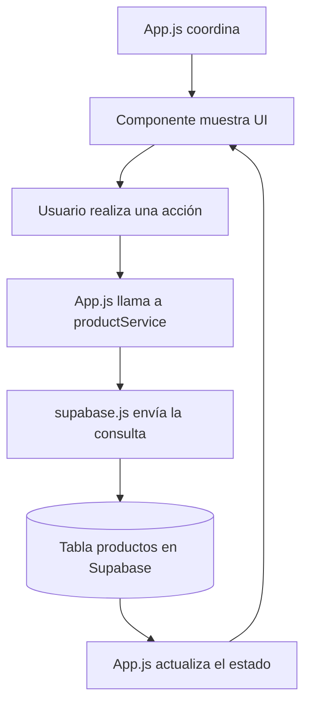

# Catálogo CRUD · React Native + Supabase

Aplicación móvil para administrar productos en Supabase. Este proyecto sigue las etapas de la actividad: crear la app, configurar el cliente de Supabase, comprobar la conexión y separar las operaciones **CREATE, READ, UPDATE y DELETE** en componentes comprensibles.

## Requisitos

- Node.js 24.3 o posterior.
- Android Studio con Android SDK para compilar el development build en Android.
- Un proyecto de [Supabase](https://supabase.com/).

## 1. Preparar la base de datos

En Supabase abre **SQL Editor → New query**, pega el contenido de [`supabase.sql`](./supabase.sql) y pulsa **Run**. El script crea `public.productos` con estas columnas:

| Columna | Tipo | Para qué sirve |
| --- | --- | --- |
| `id` | `bigint` | Identificador único que genera PostgreSQL. |
| `producto` | `text` | Nombre obligatorio, hasta 100 caracteres. |
| `descripcion` | `text` | Descripción opcional, hasta 500 caracteres. |
| `precio` | `numeric(10, 2)` | Precio obligatorio, igual o mayor que cero. |
| `created_at` | `timestamptz` | Fecha y hora de creación automática. |

El SQL activa **RLS** (seguridad por filas) y agrega políticas para que esta práctica pueda leer y modificar productos sin iniciar sesión. Para una app real se deben restringir esas políticas a usuarios autenticados. Nunca se debe poner una `service_role` key en una app móvil.

## 2. Configurar el cliente de Supabase

En Supabase abre **Project Settings → API** y copia la **Project URL** y la **publishable key**. Crea `SupabaseCRUD/.env` a partir de `.env.example` y coloca los valores:

```env
EXPO_PUBLIC_SUPABASE_URL=https://tu-proyecto.supabase.co
EXPO_PUBLIC_SUPABASE_PUBLISHABLE_KEY=tu_publishable_key
```

`supabase.js` lee esas dos variables y crea el cliente con `createClient()`. Si falta alguna, deja el cliente como `null`; el servicio lo detecta y presenta un error útil. `.env` está excluido de Git. La publishable key está diseñada para usarse en el cliente cuando RLS está configurado correctamente.

## 3. Instalar y ejecutar

Este proyecto usa **Expo SDK 58**, React Native 0.88 y React 19.3. Ejecuta los comandos desde esta carpeta:

```bash
npm install
npm run android
```

`npm run android` crea e instala el development build en un emulador Android abierto o en un teléfono conectado por USB con depuración habilitada. Después, para iniciar Metro y abrir el proyecto en el development build:

```bash
npm start
```

Durante el lanzamiento de SDK 58, Expo Go compatible aún puede no estar disponible en las tiendas; en ese caso se debe usar el development build incluido en esta configuración. La versión de Expo Go disponible en la tienda debe coincidir con el SDK del proyecto.

## 4. Cómo se divide el proyecto

```text
SupabaseCRUD/
├── App.js
├── supabase.js
├── supabase.sql
└── src/
    ├── components/
    │   ├── ConnectionBanner.js
    │   ├── InventorySummary.js
    │   ├── ProductCard.js
    │   ├── ProductForm.js
    │   └── ProductList.js
    └── services/
        └── productService.js
```

Cada archivo tiene una responsabilidad concreta:

| Archivo | Responsabilidad |
| --- | --- |
| `App.js` | Coordina la pantalla: guarda el estado, comprueba conexión, llama al servicio y decide qué componente mostrar. |
| `supabase.js` | Inicializa el cliente de Supabase con la URL y la publishable key. |
| `src/services/productService.js` | Contiene las consultas a la tabla: prueba de conexión y funciones para crear, leer, actualizar y borrar. |
| `ConnectionBanner.js` | Muestra si la app está conectando, conectada o tuvo un error. |
| `InventorySummary.js` | Calcula y muestra cuántos productos hay y el valor total del inventario. |
| `ProductForm.js` | Administra los campos, valida nombre y precio, y envía el producto nuevo o editado a `App.js`. |
| `ProductList.js` | Renderiza la lista con `FlatList`, muestra carga o inventario vacío y permite actualizar al deslizar. |
| `ProductCard.js` | Presenta un producto y sus botones de editar y eliminar. |
| `supabase.sql` | Define la tabla, sus restricciones, RLS y políticas de acceso para la actividad. |

## 5. Cómo viaja una acción por la app



La idea clave es que **los componentes no consultan Supabase directamente**. `ProductForm` recoge y valida los datos; `App.js` recibe esos datos; `productService.js` hace la consulta; y `App.js` actualiza el estado para que React vuelva a dibujar la pantalla.

## 6. Funcionamiento paso a paso

### Al abrir la aplicación: conexión y lectura

1. `App.js` ejecuta `connectAndLoad()` al montarse, mediante `useEffect`.
2. `testConnection()` en `productService.js` intenta consultar un `id` de `productos`.
3. Si responde, `getProducts()` lee todos los productos y los ordena del más nuevo al más antiguo.
4. `setProducts(data)` guarda los resultados. React vuelve a dibujar la pantalla con el inventario.
5. `ConnectionBanner` muestra el estado. Si ocurre un error, presenta el mensaje para ayudar a identificar la configuración que falta.

### CREATE: agregar un producto

1. Escribe nombre, descripción y precio en `ProductForm`.
2. `submit()` revisa que haya nombre y que el precio sea un número válido no negativo. Acepta coma o punto decimal.
3. El formulario llama `onSave(datos)`, que llega a `handleSave()` en `App.js`.
4. Si no se está editando un producto, `handleSave()` llama `createProduct(datos)`.
5. `productService.js` ejecuta `.insert(datos)` en Supabase.
6. Cuando termina, `refreshProducts()` vuelve a leer la tabla y la tarjeta aparece en pantalla.

### READ: consultar el inventario

`getProducts()` usa `.select('*')` para leer las filas y `.order('created_at', { ascending: false })` para mostrar primero las más recientes. `ProductList` las representa usando `FlatList`, que crea las tarjetas de forma eficiente.

### UPDATE: editar un producto

1. El botón **Editar** de `ProductCard` llama `setEditingProduct(product)` en `App.js`.
2. `ProductForm` recibe el producto en `initialProduct` y coloca sus valores en los campos.
3. Al guardar, `handleSave()` detecta que existe un producto seleccionado y llama `updateProduct(id, datos)`.
4. El servicio ejecuta `.update(datos).eq('id', id)`: modifica solo la fila cuyo identificador coincide.
5. La app consulta de nuevo y muestra los cambios. **Cancelar edición** limpia la selección y vuelve al formulario de alta.

### DELETE: eliminar un producto

1. El botón **Eliminar** de `ProductCard` llama `handleDelete(product)`.
2. `App.js` pide confirmación con `Alert.alert()` para evitar borrados accidentales.
3. Si se confirma, el servicio ejecuta `.delete().eq('id', id)`.
4. La app vuelve a consultar Supabase; el producto eliminado ya no aparece.

## 7. Glosario corto

- **Estado (`useState`):** datos que React conserva mientras se usa la pantalla. Al cambiar, React vuelve a renderizar los componentes que dependen de ellos.
- **Prop:** dato o función que un componente padre pasa a un componente hijo; por ejemplo, `ProductForm` recibe `onSave`.
- **`async` / `await`:** permite esperar respuestas de la red sin bloquear la interfaz.
- **CRUD:** siglas de Create, Read, Update y Delete (crear, leer, actualizar y eliminar).
- **RLS:** reglas de PostgreSQL que determinan qué filas puede consultar o modificar cada rol.

## Tecnologías

React Native · Expo SDK 58 · Supabase JavaScript Client · PostgreSQL · Row Level Security
